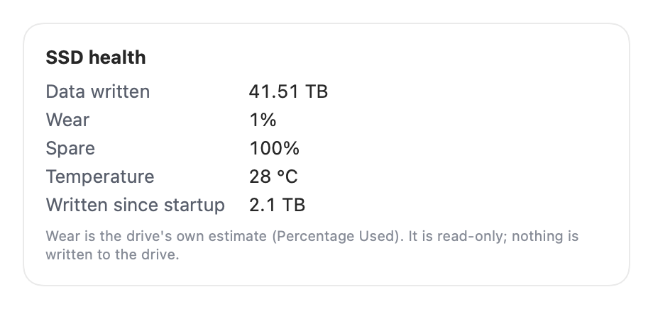
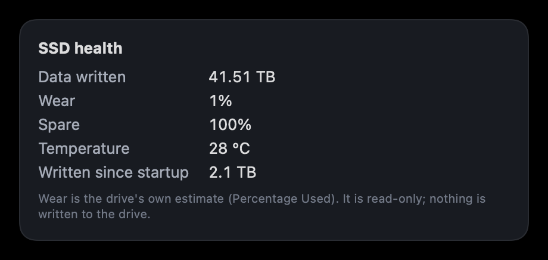
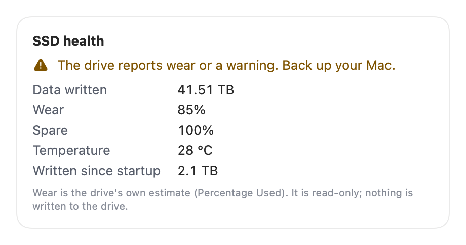

# SSD health card

H9. Read-only. Shown on the Storage screen.

## What it shows

"Data written · Wear · Spare · Temperature · Written since startup". A warning ("Back up your Mac") appears when wear is
80 % or more, the spare is below its threshold, or the drive's critical-warning byte is non-zero.

- **Wear** is the controller's own estimate (NVMe *Percentage Used*), whole percent. ADK does not predict remaining life
  or compute "TB left": Apple publishes no endurance rating.
- **Written since startup** comes from the same IOKit statistics H1 uses (host writes to the whole disk, resets at reboot).
- Power-on hours, power cycles, unsafe shutdowns and media errors are parsed but not shown (power-on hours doesn't track
  wall-clock time on Apple SSDs).

## How it reads

`Sources/CNVMeSMART` (about 60 lines of C) finds the internal `IOBlockStorageDevice` with `"NVMe SMART Capable" = Yes`,
loads Apple's `NVMeSMARTLib.plugin` through the public header `IOKit/storage/nvme/NVMeSMARTLibExternal.h`, and calls
`SMARTReadData` once. `SSDHealth` (Swift) parses the packed 512-byte page.

- No root, no entitlement, no `smartctl`, no subprocess, no vendor log pages, no writes to the device.
- The serial number is never read or shown.
- One read when the Storage screen appears, cached for 10 minutes. No polling, nothing in the menu bar.
- Any failure (virtual disk, external enclosure, plug-in version other than 1) shows "Health data isn't available for this disk".
- A sandboxed build would need `com.apple.security.temporary-exception.iokit-user-client-class` = `AppleNVMeSMARTUserClient`; ADK is not sandboxed.

## Tests

The parser runs on a recorded 512-byte page. A live read runs only with `ADK_HW_TESTS=1` on real hardware (skipped on CI
and in the Tart VM).

## QA

Owner's Mac, read-only: open Storage and compare with `smartctl`-style values (wear ~1 %, spare 100 %). In the VM the card
must say "Health data isn't available for this disk". See `scripts/qa/H9.sh`.

## Screenshots

Rendered from the recorded fixture by `SSDCardRenderTests` (set `ADK_SNAPSHOT_DIR` to regenerate); a VM has no NVMe SMART, so the ready card can't be shown there.

